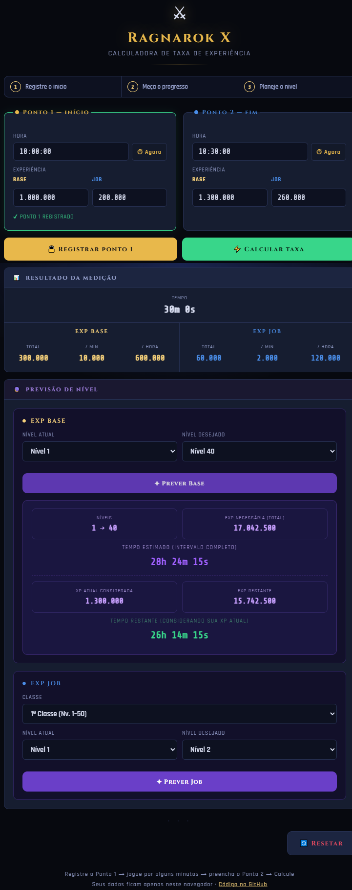

# Calculadora de XP — Ragnarok X

[](https://rhoneycruz-ui.github.io/calculadora-xp-ragnarok/)
[](https://github.com/rhoneycruz-ui/calculadora-xp-ragnarok/actions/workflows/ci.yml)
[](https://developer.mozilla.org/pt-BR/docs/Web/JavaScript)

Aplicação web para medir a velocidade de ganho de EXP Base e Job e estimar o tempo necessário para alcançar níveis futuros em Ragnarok X.

[**Usar a calculadora online**](https://rhoneycruz-ui.github.io/calculadora-xp-ragnarok/)



## O que a calculadora faz

- compara dois pontos de medição, inclusive quando o intervalo cruza a meia-noite;
- calcula EXP obtida, EXP por minuto e EXP por hora;
- mantém resultados separados para Base e Job;
- estima a EXP e o tempo restantes entre níveis;
- funciona em computadores e celulares;
- processa tudo localmente, sem conta, servidor ou envio dos valores digitados.

## Como usar

1. Informe a hora e a EXP Base/Job iniciais.
2. Selecione **Registrar ponto 1**.
3. Jogue por alguns minutos e informe a segunda medição.
4. Selecione **Calcular taxa**.
5. Escolha o nível atual e o desejado para calcular a previsão.

## Desenvolvimento local

O projeto usa apenas HTML, CSS e JavaScript nativo. Para evitar restrições de módulos ES ao abrir arquivos diretamente, sirva a pasta localmente:

```bash
python -m http.server 8000
```

Depois, acesse `http://localhost:8000`.

Para executar os testes, use Node.js 24 ou mais recente:

```bash
npm test
```

## Estrutura

```text
.
├── index.html              # interface e integração com o navegador
├── src/
│   ├── calculator.js       # regras de cálculo testáveis
│   └── experience-data.js  # tabelas de EXP preservadas e verificadas
├── tests/
│   └── calculator.test.js  # testes do núcleo
├── docs/
│   └── preview.png         # imagem usada neste README
└── .github/workflows/
    └── ci.yml              # testes e publicação no GitHub Pages
```

## Privacidade e limitações

A calculadora não possui backend ou banco de dados. Os valores permanecem na página aberta e são apagados ao recarregar.

As tabelas de EXP estão incorporadas ao projeto e podem precisar de atualização quando o jogo mudar. As estimativas também dependem de medições corretas e de uma taxa de ganho relativamente estável.

Projeto independente, sem vínculo oficial com Ragnarok X, Nuverse, Gravity ou suas afiliadas.
